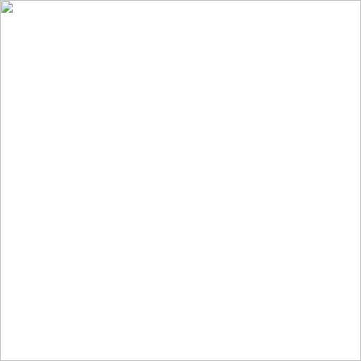
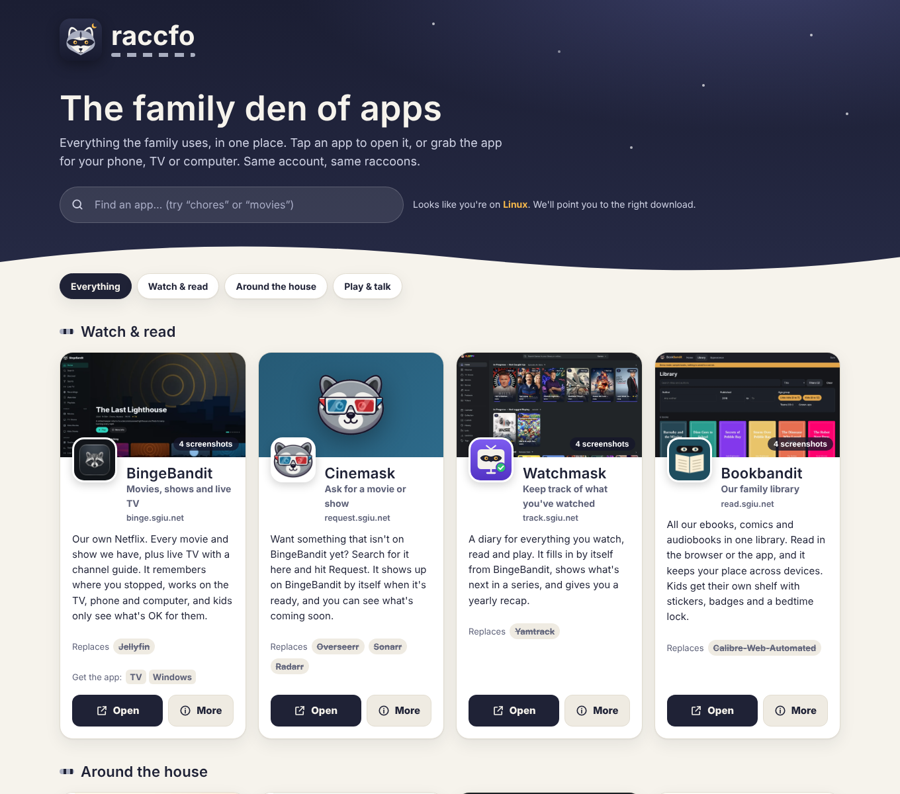

<p align="center"></p>

<h1 align="center">raccfo</h1>

<p align="center">The family den of apps. One page with every self-hosted app the family uses: what it does, what it replaces, screenshots, a button to open it, and the right app download for your phone, TV or computer.</p>

<p align="center"></p>

## What's on it

Each app gets a card with its icon, a plain-language explanation, what it replaced, screenshots and an **Open** button. **More** opens a page with the full story, a screenshot gallery, the downloads and a few tips.

| App | Address | What it is | Replaces |
| --- | --- | --- | --- |
| BingeBandit | binge.sgiu.net | Movies, shows and live TV | Jellyfin |
| Cinemask | request.sgiu.net | Ask for a movie or show | Overseerr, Sonarr, Radarr |
| Watchmask | track.sgiu.net | Keep track of what you've watched | Yamtrack |
| Bookbandit | read.sgiu.net | The family library | Calibre-Web-Automated |
| Den Duty | chores.sgiu.net | Chores, points and rewards | |
| Nighttime Ninja | kitchen.sgiu.net | Recipes, pantry and shopping list | KitchenOwl |
| RaccBoard | todo.sgiu.net | To-do lists and projects | Vikunja |
| Wishes | wishes.sgiu.net | Family wish lists | |
| Weather Scout | wx.sgiu.net | Kid-friendly weather | |
| LootDen | gm.sgiu.net | The game library | GameVault, RomM |
| DenDrop | drop.sgiu.net | Family chat and calls (new) | |

**Downloads stay up to date by themselves.** raccfo looks at each app's GitHub releases (cached for an hour) and offers the newest Android APK, Android TV / Fire TV APK, Roku channel, Windows installer, Mac or Linux build it finds. It guesses the visitor's device and highlights the matching download. Apps with no client of their own get "Add to Home Screen" instructions instead.

Only public addresses are on the site. No local IPs or ports are stored anywhere in this repo.

## Run it

### Docker Compose

```sh
docker compose up -d
```

Then open `http://<server>:8642` and point your reverse proxy at it. See [docker-compose.yml](docker-compose.yml).

### Unraid

From the Unraid terminal:

```sh
wget -O /boot/config/plugins/dockerMan/templates-user/my-raccfo.xml \
  https://raw.githubusercontent.com/Spacegoose02/raccfo/main/unraid/raccfo.xml
```

Then **Docker → Add Container**, pick **raccfo** from the template list and **Apply**. The defaults (port 8642, `/mnt/user/appdata/raccfo`) work as they are.

Or by hand: **Docker → Add Container**, repository `ghcr.io/spacegoose02/raccfo:latest`, bridge network, container port `8080` to any free host port, and optionally a path `/config` → `/mnt/user/appdata/raccfo`.

The image is published to GHCR by the [Docker workflow](.github/workflows/docker.yml) on every push to `main` (amd64 and arm64).

### Without Docker

Node 20 or newer, no `npm install` needed:

```sh
npm start          # http://localhost:8080
```

## Settings

| Variable | Default | What it does |
| --- | --- | --- |
| `PORT` | `8080` | Port inside the container |
| `CONFIG_DIR` | `/config` | Folder for your own `apps.json`, icons and screenshots |
| `RELEASE_CACHE_MINUTES` | `60` | How long to remember each app's GitHub releases |
| `GITHUB_TOKEN` | (unset) | Optional read-only token; raises GitHub's limit from 60 to 5000 calls an hour |

## Adding or changing an app

Everything on the page comes from [`site/apps.json`](site/apps.json). To change it without rebuilding the image, copy that file to your config folder (`/mnt/user/appdata/raccfo/apps.json` on Unraid) and edit it. raccfo reads it on every page load.

Each app looks like this:

```jsonc
{
  "slug": "raccboard",                 // short id, also the #link to its page
  "name": "RaccBoard",
  "category": "home",                  // one of the ids in "categories"
  "url": "https://todo.sgiu.net",
  "icon": "icons/raccboard.png",       // in site/ or your config folder
  "accent": "#12a08a",                 // color behind the icon
  "tagline": "To-do lists and projects",
  "description": "Plain-language explanation for the family.",
  "replaces": ["Vikunja"],
  "isNew": false,                      // shows a NEW badge
  "tips": ["Short how-to lines shown on the app's page."],
  "repo": "Spacegoose02/raccboard",    // where downloads come from; leave out for none
  "downloads": {                       // optional filters on release file names (regex)
    "include": "RaccBoard-",
    "exclude": "debug",
    "links": [{ "platform": "android", "label": "Android", "kind": "Play Store", "url": "https://..." }]
  },
  "screenshots": [{ "src": "screenshots/raccboard/board.webp", "caption": "A board" }]
}
```

Drop new screenshots in `config/screenshots/<slug>/` and icons in `config/icons/`; they're served at the same paths as the built-in ones and win over them.

## How it's built

- `server.js`: a dependency-free Node server. Serves `site/`, overlays `/config`, and answers `/api/apps` and `/api/downloads` (the GitHub release lookup). Health check at `/healthz`.
- `site/`: the page itself (plain HTML, CSS and JS), the raccoon logo in `site/brand/`, app icons and screenshots.
- `test/`: `npm test` checks which release files count as downloads.

## Credits

App icons and most screenshots come from each app's own repository. The raccfo raccoon and the Watchmask placeholder icon were drawn for this repo.
